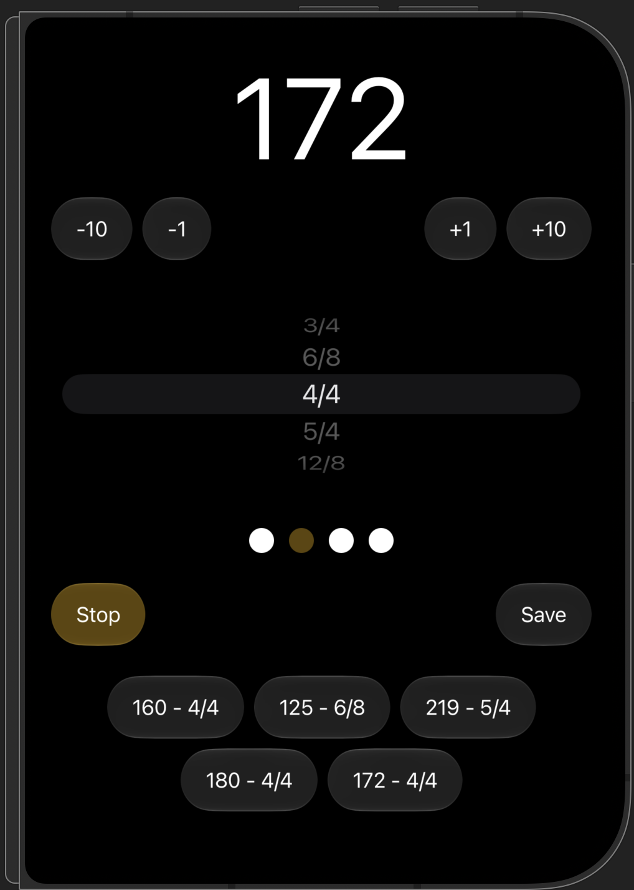

# Metronome

A simple metronome app built with SwiftUI.

It lets you adjust the tempo, choose a time signature, start and stop the metronome, and save tempo and signature combinations for later use.

## Requirements

Xcode 27 or later.

iOS 26 or later.

## Open the project

Open `Metronome.xcodeproj` in Xcode and run the Metronome target on an iPhone or simulator.

